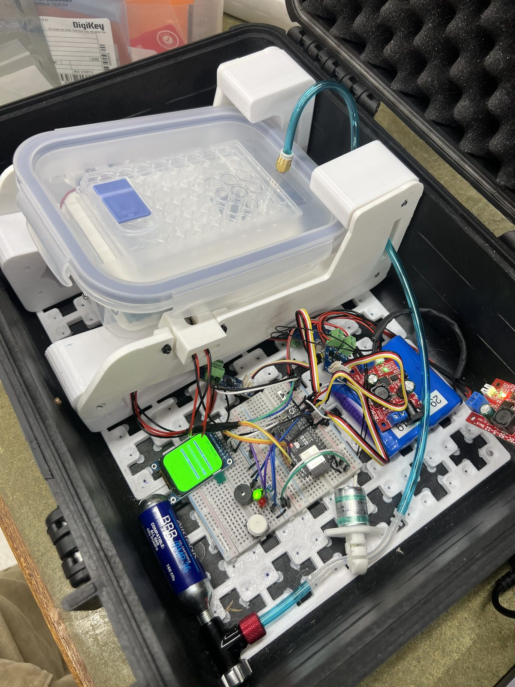
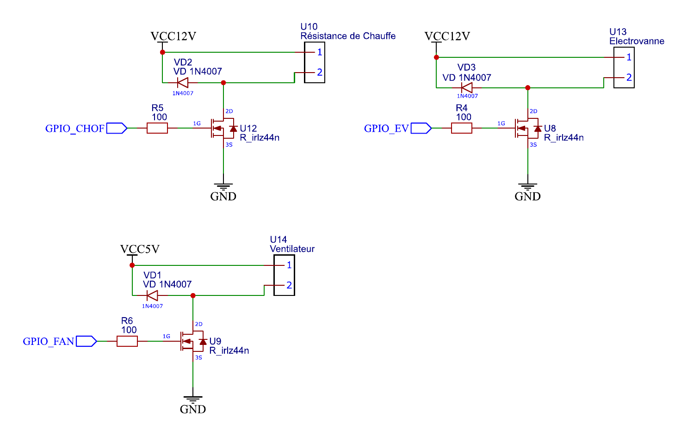
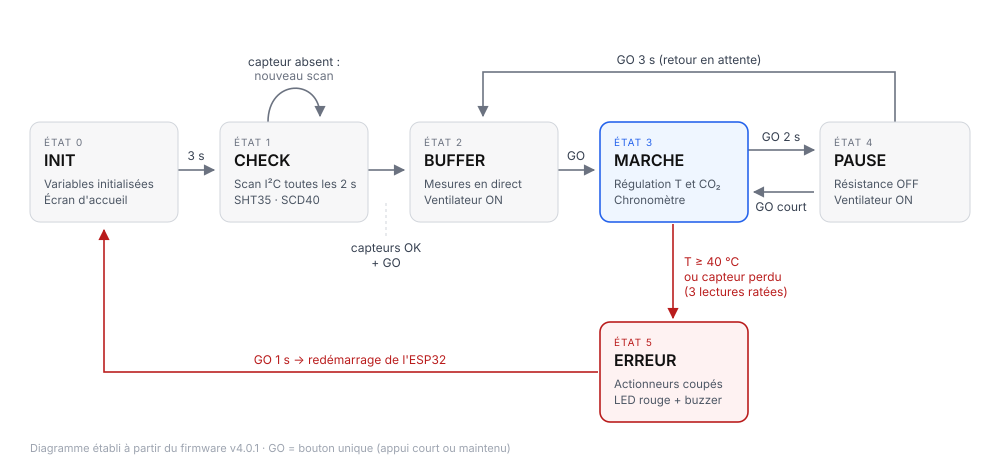
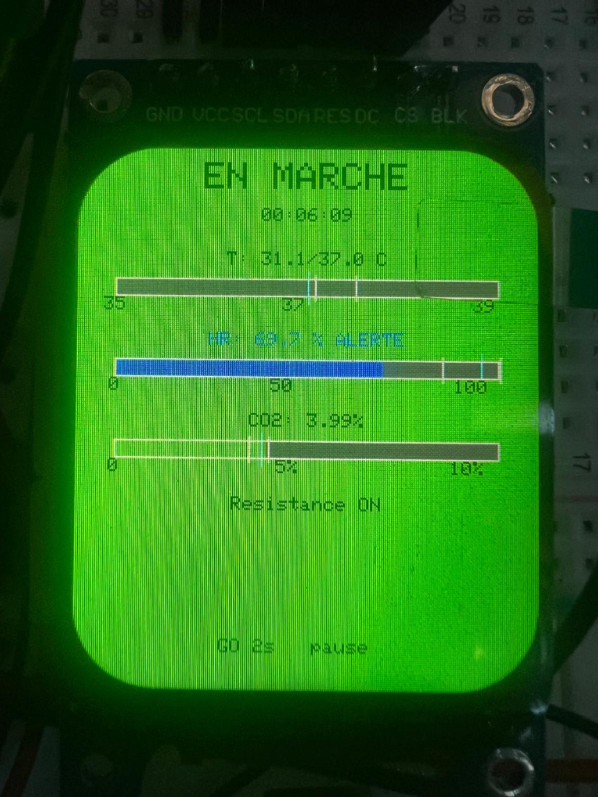
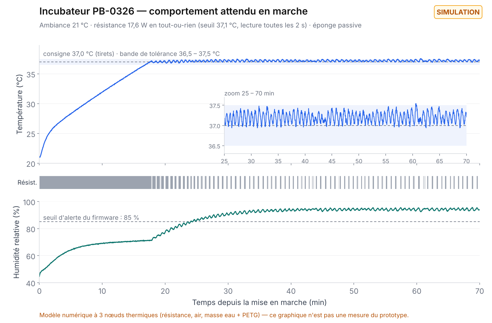

# PB-0326 — Incubateur transportable pour cellules

Boîtier autonome qui transporte des cellules vivantes pendant une heure de train entre Lausanne et Genève, en maintenant **37 °C**, une humidité proche de **100 %** et un **pH de 7,2 à 7,4** grâce à l'injection de CO₂.

Projet Thématique 2026 — HEPIA (HES-SO Genève), Bachelor en ingénierie microtechnique, spécialisation biomédicale.
**Auteurs : Lyla Founas et Mattéo Pozzo di Borgo.**



---

## Le problème

Les cellules mammifères ne survivent qu'à 37 °C, dans une atmosphère saturée en humidité (sinon le milieu s'évapore et devient cytotoxique) et à un pH de 7,2 à 7,4, régulé par le CO₂ dissous. Les solutions commerciales (Cellbox Go, Phoenix…) sont conçues pour des trajets de 12 à 72 h : lourdes et coûteuses pour un trajet d'une heure. D'où ce prototype sur mesure.

**Cahier des charges**

| Critère | Valeur cible |
|---|---|
| Autonomie | ≥ 1 h sans prise secteur |
| Poids / format | < 10 kg, valise cabine 45 × 36 × 20 cm |
| Température zone biologique | 37,0 °C ± 0,5 °C |
| Humidité relative | ≈ 100 % |
| pH du milieu (via CO₂) | 7,2 – 7,4 |
| Préparation | < 5 min, sans formation technique |

## Architecture

Un **boîtier biologique amovible** (tupperware équipé) se dépose dans la valise ; des **connecteurs aimantés** établissent d'un seul geste l'alimentation, les capteurs et la chauffe (système « pick and place »).

| Fonction | Solution retenue |
|---|---|
| Chauffage | Résistance bobinée 8,2 Ω (50 W nominaux, ≈ 17,6 W sous 12 V), MOSFET IRLZ44N |
| Humidification | Éponge cellulose passive |
| Régulation du pH | Injection de CO₂ : réservoir → détendeur → électrovanne → zone biologique |
| Mesure T / HR | Sensirion SHT35 (I²C) dans la zone biologique |
| Mesure CO₂ | Sensirion SCD40 (I²C), protégé de l'humidité par une membrane Nafion |
| Brassage | Ventilateur 5 V sur MOSFET |
| Contrôle | ESP32-DevKitC |
| Interface | Écran ST7789 240 × 280, LED rouge d'alerte, LED I²C, buzzer, bouton GO |
| Alimentation | 2 × LiPo 3S 5000 mAh + BMS, DC-DC 12 V (puissance) et 5 V (logique) |

Schéma électronique complet : [`electronique/schema_electronique.pdf`](electronique/schema_electronique.pdf)



## Firmware

Le firmware ([`firmware/firmware_PB0326/firmware_PB0326.ino`](firmware/firmware_PB0326/firmware_PB0326.ino)) est organisé autour d'une machine à états finis, pilotée par un seul bouton **GO** :



L'**historique Git** de ce dépôt retrace l'évolution réelle du code, de la v2.0 (22 mai 2026) à la v4.0.1 (juin 2026), où le module Peltier a été remplacé par la résistance chauffante.

### Compiler et téléverser

1. **Arduino IDE** avec le paquet de cartes **esp32** (Espressif), carte **ESP32 Dev Module**.
2. Bibliothèques (gestionnaire de bibliothèques) :
   - `TFT_eSPI` (Bodmer)
   - `Adafruit SHT31 Library` (Adafruit)
3. Configurer l'écran : remplacer `User_Setup.h` dans le dossier de la bibliothèque TFT_eSPI par [`firmware/User_Setup.h`](firmware/User_Setup.h).
   ⚠️ Ce fichier a été reconstitué d'après les commentaires du code : à vérifier au premier essai.
4. Ouvrir `firmware/firmware_PB0326/firmware_PB0326.ino` et téléverser.
5. Moniteur série à **115 200 bauds** : les mesures T et HR s'affichent toutes les 2 s.

### Brochage

| Signal | GPIO |
|---|---|
| Résistance chauffante (MOSFET) | 32 |
| Ventilateur (MOSFET) | 14 |
| Électrovanne CO₂ (MOSFET) | 27 |
| LED rouge (erreur) | 19 |
| LED I²C (capteur détecté) | 4 |
| Bouton GO | 5 |
| Buzzer | 25 |
| I²C — SDA / SCL | 21 / 22 |
| Écran SPI — MOSI / SCLK / CS / DC / RST | 23 / 18 / 15 / 2 / 33 |

## Résultats

Les essais ont été menés avec la boîte de culture vide : l'affichage, la régulation de la température, de l'humidité et du CO₂ ainsi que les sécurités (passage en ERREUR, coupure des actionneurs, alerte) fonctionnent comme prévu.



La tenue des paramètres sur une heure complète n'a **pas encore été enregistrée**. En attendant, une **simulation numérique** du comportement attendu, fondée sur la loi de commande réelle du firmware, est disponible dans [`docs/simulation/`](docs/simulation/) (script Python reproductible) :



## Contenu du dépôt

```
firmware/        Code ESP32 (Arduino) + configuration de l'écran
electronique/    Schéma (PDF + images), projets KiCad, carte support SHT3x avec fichiers Gerber
mecanique/
  cao/           Fichiers Creo (versions finales) et Inventor
  impression-3d/ Fichiers STL et 3MF des pièces imprimées
  rendus/        Rendus CAO
docs/            Présentation, planning, rapport intermédiaire, diagrammes, simulation
media/           Photos et vidéo du prototype
```

## Documents

- [`docs/presentation_PB0326.pdf`](docs/presentation_PB0326.pdf) — **présentation finale (juin 2026), document de référence** pour les choix du prototype.
- [`docs/rapport_intermediaire_catalogue_idees.pdf`](docs/rapport_intermediaire_catalogue_idees.pdf) — catalogue d'idées et analyse des solutions, rédigé pendant la **phase d'exploration**. Certains choix y diffèrent du prototype final (module Peltier, tampon HEPES, sonde pH) : ils ont été revus ensuite, voir la présentation.
- [`docs/gantt_PB0326.pdf`](docs/gantt_PB0326.pdf) — planning du projet.

## Modèles tiers non inclus

Pour des raisons de licence, les modèles CAO fournis par des fabricants ne sont pas redistribués ici. Certains assemblages peuvent donc signaler des références manquantes :

- valise Pelican 1450 ;
- capteur Sensirion SCD40 ;
- pogo pins Attend 303C-321018-30-04 ;
- bibliothèque de symbole ESP32-DevKitC-32U (KiCad).

Ils sont téléchargeables gratuitement sur les sites des fabricants.

## Pistes d'amélioration

- Suivi à distance par Wi-Fi (application mobile) avec alerte pendant le trajet
- Régulation PID de la température pour réduire les oscillations
- Enregistrement des paramètres sur toute la durée du transport
- Module Peltier pour pouvoir aussi refroidir
- Humidification par injection de vapeur

## Licence

- Code (`firmware/`, `docs/simulation/`) : **MIT**
- Conception, documents et images : **CC BY-NC-SA 4.0**

Voir [`LICENSE`](LICENSE) et [`LICENSE-CC-BY-NC-SA-4.0.md`](LICENSE-CC-BY-NC-SA-4.0.md).

---

Portfolio de Mattéo Pozzo di Borgo : [p0770.github.io](https://p0770.github.io/projects/incubateur-cellules)
